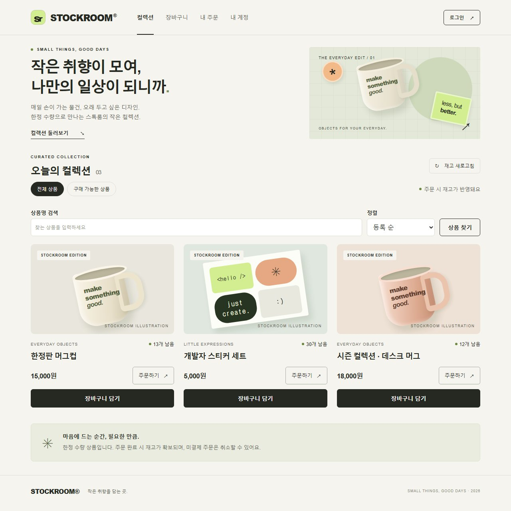

# STOCKROOM — 한정 수량 주문·재고 서비스

동시 주문과 네트워크 재시도에도 재고·주문 상태를 일관되게 유지하는 Java/Spring 기반 주문·재고 서비스입니다.
상품 조회부터 회원가입·로그인·주문·취소와 로컬 모의 결제·환불까지 웹 화면에서 실행합니다.

[GitHub 저장소](https://github.com/zeroziba9-hash/order-stock-service) ·
[Backend CI 실행 내역](https://github.com/zeroziba9-hash/order-stock-service/actions/workflows/ci.yml) ·
[Docker Compose CI](https://github.com/zeroziba9-hash/order-stock-service/actions/workflows/docker.yml)



## 핵심 설계와 검증

| 문제 | 구현 | 확인 방법 |
|---|---|---|
| 한정 재고에 동시 주문 | 상품 행 잠금, 주문·재고 단일 트랜잭션 | 실제 MySQL 동시 요청, 실패 시 전체 롤백 |
| 응답 유실 뒤 주문 재시도 | 회원별 멱등 키, 같은 요청은 기존 주문 반환 | 같은 키 동시 요청과 브라우저 응답 유실 재현 |
| 반복 취소·환불 | 주문 잠금과 상태 전이, 재고 한 번만 복구 | 동시 취소·환불·결제 경쟁 검증 |
| 미결제 재고 장기 점유 | 생성 시 마감 고정, 배치 자동 만료, 늦은 결제 차단 | 실제 스케줄러·만료/취소/결제 경쟁·롤백 |
| 다른 회원의 주문 접근 | 세션 인증, 소유자 조건 조회, CSRF | 타인 상세·이력 접근 거부와 세션 만료 검증 |
| 앱 재시작 때 로그인 유실 | MySQL 세션 저장, 유휴 만료·로그아웃 삭제, 복구 시 과거 세션 무효화 | 실제 컨테이너 재생성·같은 쿠키/CSRF·권한 회수·백업 복원 검증 |
| 인증 요청 폭주 | IP별 요청 수 + IP·이메일별 실패/진행 중 검사 제한 | 동시 로그인·헤더 위조·429 대기·수동 복구·고정 라벨 지표 |
| 운영·복구 | prod 보호, Caddy HTTPS, 별도 빈 DB 복원 | Compose·TLS·백업 복원 CI |
| API와 문서 불일치 | 실제 보안 필터·MySQL 테스트에서 REST Docs 생성 | 필드 계약 검증, 토큰 마스킹 검사, HTML 생성 CI |
| 관리자 수동 재고 변경 | 역할 확인, 상품 잠금, 사유·전후 수량 이력, 필수 요청 키 | 동시 주문·재조정·응답 유실·권한 회수·이력 저장 실패 검증 |
| 상품 운영·재고 전체 이동 | 등록 멱등 키, 수정 버전, 판매 중지, 주문·복구·수동 조정 원장 | 오래된 수정 차단, 원장 실패 전체 롤백, 전체 잔액 대조 |
| 상품 수정 추적 | 이름·가격·판매 상태의 전후 값·관리자 ID·UTC 시각 | 상품·이력 동시 롤백, 동시 수정, no-op·커서·권한·브라우저 복구 |
| 차감 방식 성능 비교 | 기본 행 잠금과 실험용 조건부 UPDATE, 워밍업·교대·3회 반복 | 충분한 재고의 성공 주문만 측정, 상품별 원장·취소 복구 확인 |
| 처리 결과와 실행 상태 관측 | 커밋 후 주문 지표, 내부 관리 포트, Prometheus·Grafana | 롤백·동시 요청·실제 만료와 18개 패널 쿼리 CI |
| 장애 감지와 복구 확인 | 앱 scrape·5xx·인증 제한·용량·만료 롤백 경고, 지속 시간·대응 문서 | promtool 26개 기대 상태, 실제 앱 중단→복구·인증 폭주 경고 CI |
| 장애 요청과 로그 연결 | 서버 발급 추적 ID, 보안 필터 앞 완료 로그, 안전한 500 처리 | 실제 Tomcat의 인증·CSRF·제한·오류 응답, 동시 스레드 격리·민감정보 제외 |

Java 17 · Spring Boot 4.0.8 · Spring Security · Spring Data JPA · MySQL 8.4 · Flyway ·
HTML/CSS/JavaScript · Docker Compose · Caddy · Micrometer · Prometheus · Grafana · GitHub Actions를 사용합니다.

**확인된 결과:** 백엔드 테스트 292개를 두 차감 방식에서 각각 통과, 데스크톱·모바일 Chromium E2E 40개 통과(일반 14 + 관리자 18 + 자동 만료 2 + 인증 제한 6).
별도 HTTP 부하 검증에서 동시성 1·8·32 모두 재고 10개에 주문 10건만 생성했습니다.
후속 차감 방식 비교는 워밍업과 36회 반복 측정에서 성공 주문 8,640건·원장 잔액·취소 후 복구를 확인했고, 개선 근거가 부족해 기본 행 잠금 방식을 유지했습니다.
테스트 조건과 실제 측정값은 [설계와 검증 기록](docs/design-and-validation.md)에 정리했습니다.
브라우저·부하·배포 검증의 추가 코드는 각각 [PR #1](https://github.com/zeroziba9-hash/order-stock-service/pull/1),
[PR #2](https://github.com/zeroziba9-hash/order-stock-service/pull/2),
[PR #3](https://github.com/zeroziba9-hash/order-stock-service/pull/3)에서 독립적으로 검토할 수 있습니다.

## 실행과 읽을 문서

[Docker 실행](docs/docker.md)에 따라 `.env`를 준비한 뒤 저장소 루트에서 실행합니다.

```powershell
docker compose up --build --wait --wait-timeout 240
```

로컬 화면은 [http://localhost:18080/](http://localhost:18080/)입니다.
외부 공개 서버·도메인은 아직 연결하지 않았습니다. 실제 결제 연동은 없으며 모의 쓰기는 운영에서 차단합니다.

- [설계 선택·정합성·측정 결과](docs/design-and-validation.md)
- [테스트 기반 API 가이드 생성·다운로드](docs/api-documentation.md)
- [요청 추적 ID·민감정보를 제외한 장애 로그](docs/request-tracing.md)
- [MySQL 세션 저장·재시작·만료·복구 정책](docs/session-persistence.md)
- [기능 브랜치·PR 작업 규칙](docs/development-workflow.md)
- [인증](docs/auth.md) · [인증 요청 제한](docs/auth-limits.md) · [주문 API](docs/order-api.md) · [주문 규칙](docs/order-rules.md)
- [멱등 요청](docs/idempotency.md) · [모의 결제](docs/payments.md) · [모의 환불](docs/refunds.md)
- [미결제 주문 자동 만료](docs/order-expiration.md)
- [관리자 권한·재고 조정·변경 이력](docs/admin-inventory.md)
- [상품 등록·수정·판매 중지·전체 재고 원장](docs/catalog-and-ledger.md)
- [상품 정보 변경 이력·트랜잭션·조회 화면](docs/catalog-change-history.md)
- [경고 기준·장애 대응·실제 상태 전이 검증](docs/alert-runbook.md)
- [워밍업·반복 측정을 포함한 차감 방식 비교](docs/paired-benchmark.md)
- [주문 지표·Prometheus·Grafana 로컬 대시보드](docs/observability.md)
- [웹 프론트](docs/frontend.md) · [HTTPS 배포](docs/https-deployment.md) · [백업·복원](docs/backup-restore.md)

<details>
<summary>API 사용 예제·Java 직접 실행·테스트 상세</summary>

## 주문·결제·환불과 웹 프론트·Docker 실행·CI

Java 17, Spring Boot 4.0.8, MySQL 8.4, Spring Data JPA, Flyway를 사용합니다.
Spring Security의 세션 로그인과 CSRF 검증을 사용합니다.
상품 조회는 공개이며, 주문 생성·조회·취소는 로그인한 회원의 본인 주문만 처리합니다.
회원가입·로그인·주문까지 실행하는 방법은 [인증 API 안내](docs/auth.md)를 먼저 참고하세요.
`GET /products`는 판매 중인 상품을 ID 오름차순으로 반환합니다. 판매 중지 상품은 새 주문도 차단하며, 기존 주문 취소·환불·만료는 재고를 복구합니다.
가격은 원 단위 정수이며, 가격과 재고에는 음수를 금지하는 DB 제약 조건이 있습니다.
`POST /orders`로 상품 한 종류를 주문하고 `GET /orders/{orderId}`로 주문을 조회합니다.
주문 저장과 재고 차감은 하나의 트랜잭션으로 처리합니다.
상품 행에 비관적 쓰기 잠금을 걸어 같은 상품의 주문을 순서대로 처리하고 초과 판매를 막습니다.
주문 항목에는 주문 당시 상품명과 가격을 보관합니다.
`POST /orders/{orderId}/cancel`로 미결제 주문을 취소하면 주문 수량만큼 재고를 복구합니다.
같은 주문을 반복 취소해도 재고는 한 번만 복구하며 최초 취소 시각을 유지합니다.
주문 생성에 `Idempotency-Key` 헤더를 붙이면 같은 키·같은 상품·같은 수량의 재요청은 기존 주문을 반환합니다.
같은 키로 다른 내용을 요청하면 `409` 오류입니다. [멱등 요청 안내](docs/idempotency.md)를 참고하세요.

`POST /orders/{orderId}/payments`로 모의 결제 성공·실패를 선택할 수 있습니다.
결제 성공은 `PAID`로 바꾸고, 실패는 이력을 남긴 채 `CREATED`를 유지합니다.
결제에는 요청 키가 필수이며, 같은 키의 재요청은 최초 결제 이력을 반환합니다.
결제 완료 주문에 `/cancel`을 요청하면 `409 REFUND_REQUIRED`입니다.
`POST /orders/{orderId}/refunds`로 모의 전액 환불과 주문 취소를 함께 처리합니다.
환불 성공은 `REFUNDED`로 바꾸고 재고를 한 번만 복구합니다. 실패는 이력을 남기고 `PAID`를 유지합니다.
환불에도 요청 키가 필수입니다. [모의 환불 안내](docs/refunds.md)를 참고하세요.
실제 돈이 오가지 않는 로컬 개발용 API입니다. [모의 결제 안내](docs/payments.md)를 참고하세요.

기본 `local` 프로필에서 모의 결제·환불을 실행할 수 있습니다. `prod` 프로필은 별도 DB 환경 변수와 Secure 쿠키를 요구하며
모의 결제·환불 쓰기를 차단합니다. GitHub Actions 워크플로는 MySQL 통합 테스트와 실행 JAR 빌드를 구성합니다.
운영 실행·CI·검증 범위는 [배포 안내](docs/deployment.md)를 참고하세요.
Docker 운영 구성과 Caddy HTTPS 연결 절차는 [HTTPS 배포 안내](docs/https-deployment.md)에 정리했습니다.
운영 DB 도구와 새 DB 복구 검증은 [백업·복원 안내](docs/backup-restore.md)를 참고하세요.

## 웹 화면

실행 후 [STOCKROOM 프론트](http://localhost:18080/)에서 상품 조회 → 회원가입·로그인 → 수량 선택·주문 → 내 주문·취소를 체험할 수 있습니다.
주문 상세에서 결제·환불 이력을 확인하며, 로컬 환경에서는 실제 금액이 청구되지 않는 모의 결제·전액 환불도 실행합니다.
운영 환경에서는 모의 결제·환불 버튼을 숨기고 서버에서도 해당 쓰기를 차단합니다.
별도 프론트 서버 없이 Spring Boot가 HTML·CSS·JavaScript를 제공하며 모바일 화면도 지원합니다.
직접 Java로 실행한 경우 [8080 프론트](http://localhost:8080/)를 사용합니다.
구성과 검증 방법은 [프론트 안내](docs/frontend.md)에 정리했습니다.

주문 요청 예시와 오류 응답은 [주문 API 안내](docs/order-api.md)를 참고하세요.

### 실행

다른 컴퓨터에서 시작한다면 [Docker Compose 실행 안내](docs/docker.md)를 따라 앱과 MySQL을 함께 실행할 수 있습니다.
`.env.example`을 `.env`로 복사해 두 DB 비밀번호를 채운 뒤 실행합니다.

```powershell
docker compose up --build --wait --wait-timeout 240
```

Docker 실행 주소는 [웹 화면](http://localhost:18080/), [상품 API](http://localhost:18080/products)와
[준비 상태](http://localhost:18080/actuator/health/readiness)입니다.
기존 로컬 DB와 별도 볼륨을 사용하며, 모의 결제·환불을 포함한 로컬 개발용 구성입니다.
Java·MySQL 직접 실행은 아래 안내를 사용하세요.

이 컴퓨터에는 프로젝트 전용 MySQL DB와 로컬 접속 파일이 준비되어 있습니다.
VS Code에서 이 폴더를 열고 PowerShell 터미널에서 실행합니다.

```powershell
.\scripts\start-db.ps1
.\gradlew.bat bootRun
```

첫 실행에는 Gradle과 의존성을 다운로드하므로 인터넷 연결이 필요합니다.
`Started OrderStockServiceApplication` 로그가 나오면 준비된 상태입니다.

- [상품 목록](http://localhost:8080/products)
- [서버 상태](http://localhost:8080/actuator/health)

브라우저 주소창은 조회 요청을 보냅니다. 주문 생성은 아래처럼 PowerShell에서 실행합니다.
먼저 [인증 API 안내](docs/auth.md)의 1~3번으로 로그인해 `$session`을 준비하세요.
`productId`는 상품 목록에서 확인한 ID로 지정합니다.

```powershell
$headers = @{ 'Idempotency-Key' = [Guid]::NewGuid().ToString() }
$csrf = Invoke-RestMethod 'http://localhost:8080/auth/csrf' -WebSession $session
$headers[$csrf.headerName] = $csrf.token
Invoke-RestMethod -Method Post -Uri 'http://localhost:8080/orders' `
  -WebSession $session -Headers $headers -ContentType 'application/json' -Body '{"productId":1,"quantity":2}'
```

새 키의 주문이 성공하면 실제 재고가 줄어듭니다. 같은 `$headers`로 마지막 명령을 다시 실행하면 기존 주문을 반환합니다.
새 주문에는 새 키를 발급하세요. 키를 생략하면 요청할 때마다 새 주문이 생성됩니다.
반환된 `orderId`로 주문 상세를 조회할 수 있습니다.
취소 요청은 [주문 API 안내](docs/order-api.md)의 4번을 참고하세요.

터미널에서 실행한 서버는 `Ctrl+C`로 종료합니다.
현재 백그라운드에서 실행 중인 이 프로젝트의 서버는 다음 명령으로 종료할 수 있습니다.

```powershell
.\scripts\stop-app.ps1
```

8080 포트를 사용하는 서버를 종료한 뒤 새 서버를 실행하세요.
DB 시작·접속·종료 방법은 [MySQL 안내](docs/mysql.md)를 참고하세요.

### 요청 흐름과 처음 읽을 코드

브라우저 → `ProductController` → `ProductService` → `ProductRepository` → MySQL → 응답 DTO → JSON.

1. `product/Product.java`: DB의 `products` 테이블에 대응하는 엔티티.
2. `product/ProductRepository.java`: JPA로 상품을 저장·조회하는 인터페이스.
3. `product/ProductService.java`: 읽기 전용 트랜잭션에서 조회하고 DTO로 변환.
4. `product/ProductController.java`: `GET /products` 요청 처리.
5. `product/ProductResponse.java`: 외부로 반환할 JSON 필드 정의.

엔티티를 HTTP 응답으로 직접 노출하지 않습니다.
주문 기능은 `order/OrderController.java` → `OrderService.java` →
`ProductRepository.findByIdForUpdate()` → `OrderRepository` 순서로 읽어보세요.
`src/main/resources/db/migration`의 SQL은 Flyway가 순서대로 한 번씩 실행합니다.
이미 적용한 파일을 수정하지 말고, 다음 변경은 `V11__설명.sql`처럼 새 파일로 추가하세요.
JPA의 `ddl-auto=validate`는 테이블 구조를 검증하며 DB를 초기화하지 않습니다.

### DB 값과 API 응답 연결하기

상품을 조회합니다.

```powershell
.\scripts\db.ps1 -Query 'SELECT id, name, price, stock FROM products ORDER BY id;'
```

위 결과에서 머그컵의 ID와 기존 가격을 확인하고, 해당 ID로 가격을 변경합니다.
아래 예시는 ID가 1인 경우입니다.

```powershell
.\scripts\db.ps1 -Query 'UPDATE products SET price = 17000 WHERE id = 1;'
```

`/products`를 새로고침하면 서버 재시작 없이 바뀐 가격이 표시됩니다.
서버를 재시작해도 변경한 가격이 유지됩니다. 확인 후 같은 SQL로 원래 가격을 복원하세요.

### 테스트

MySQL 실행 후, 최초 한 번 테스트 전용 DB를 준비합니다.

```powershell
.\scripts\setup-test-db.ps1
.\gradlew.bat test
```

실제 MySQL의 `order_stock_test` DB에서 상품·주문을 검증합니다.

- 저장된 상품의 조회·정렬·JSON 응답.
- DB 수정값의 API 즉시 반영.
- 상품이 없을 때 빈 배열 반환.
- 음수 재고 거부.
- 음수 가격 거부.
- 주문 저장·재고 차감·주문 당시 가격 보존.
- 재고 부족·잘못된 수량·없는 상품·금액 오버플로 거부.
- 실제 DB 쓰기 후 실패했을 때 주문과 재고 동시 롤백.
- 재고 10개에 동시 요청 20건이 들어와도 정확히 10건만 성공.
- 취소 시 재고 복구·취소 이력 보존·반복 취소 시 재고를 한 번만 복구.
- 동일 주문 동시 취소, 서로 다른 주문 동시 취소, 주문과 취소가 섞인 동시 요청.
- 취소 저장 실패 시 상태와 재고 함께 롤백, 재고 복구 시 정수 범위 초과 방지.
- 같은 키의 동시 요청 20건이 주문 한 개만 생성하고, 다른 내용의 키 재사용을 거부.
- 키 저장 실패 시 키·주문·재고 함께 롤백, 실패 후 같은 키로 재시도 가능.
- 취소 후 생성 요청을 재시도해도 기존 취소된 주문을 반환하고 재고를 차감하지 않음.
- 회원가입·BCrypt 저장·중복 이메일·실제 로그인 세션·로그아웃·CSRF 검증.
- 타인 주문 조회·취소 차단, 회원별 요청 키, 기존 익명 주문 접근 차단.
- 결제 성공·실패 이력, 주문 금액 사용, 동일 결제 재생, 새 키 재결제 차단.
- 같은 주문에 결제 요청 20건, 결제와 취소 경쟁, DB 쓰기 후 결제 저장 실패의 전체 롤백.
- 결제 이력의 본인 확인·CSRF, 성공 결제의 DB 유니크 제약.
- 환불 성공·실패, 원 결제 금액 사용, 최초 승인 이력 보존, 반복 환불·취소 시 재고 한 번만 복구.
- 같은 키·다른 키의 동시 환불 20건, 환불·취소·결제 경쟁, 다른 주문의 동일 상품 환불.
- 실제 DB 쓰기 후 환불 오류의 전체 롤백, 재고 범위 초과·잘못된 결제 연결·중복 성공 환불 거부.
- 운영 설정 누락·잘못된 프로필 조합·모의 쓰기 허용·Secure 쿠키 해제 거부.
- 모의 API 차단 시 데이터 유지와 본인 이력 조회 유지.

테스트는 전용 DB 데이터를 정리합니다. 테스트 계정은 개발 DB 접근 권한이 없습니다.
접속 비밀번호와 DB 데이터는 Git에서 제외된 `.local/`에 저장됩니다.
다른 컴퓨터에서는 MySQL DB와 계정을 생성한 뒤 `SPRING_DATASOURCE_URL`,
`SPRING_DATASOURCE_USERNAME`, `SPRING_DATASOURCE_PASSWORD` 환경 변수로 앱에 연결할 수 있습니다.
테스트에는 별도의 `order_stock_test` DB가 필요합니다. 접속 정보는 `.local/mysql/spring-test.properties` 또는
`SPRING_DATASOURCE_*` 환경 변수로 전달합니다. GitHub CI는 일회용 MySQL 컨테이너와 환경 변수를 사용합니다.

## 다음 단계

1. 기능별 PR을 검토하고 main의 백엔드·브라우저·부하·복구·업그레이드 CI를 유지합니다.
2. 실제 서버·도메인 연결 후 공개 HTTPS와 서버 밖 백업·복구를 확인합니다.
3. 충분한 실행 시간·반복 측정과 서버 계측을 추가한 뒤 성능 개선을 비교합니다.

기존 익명 주문과 요청 키는 소유자 없이 보존하며, 신규 회원에게 자동 귀속하지 않습니다.
로그인 세션은 MySQL에 저장하므로 유효한 쿠키가 있으면 앱 재시작 뒤에도 유지됩니다. 최초 V13 적용과 백업 복원 뒤에는 다시 로그인합니다.

주문 규칙은 [주문 규칙 문서](docs/order-rules.md)에 정리합니다.

</details>
