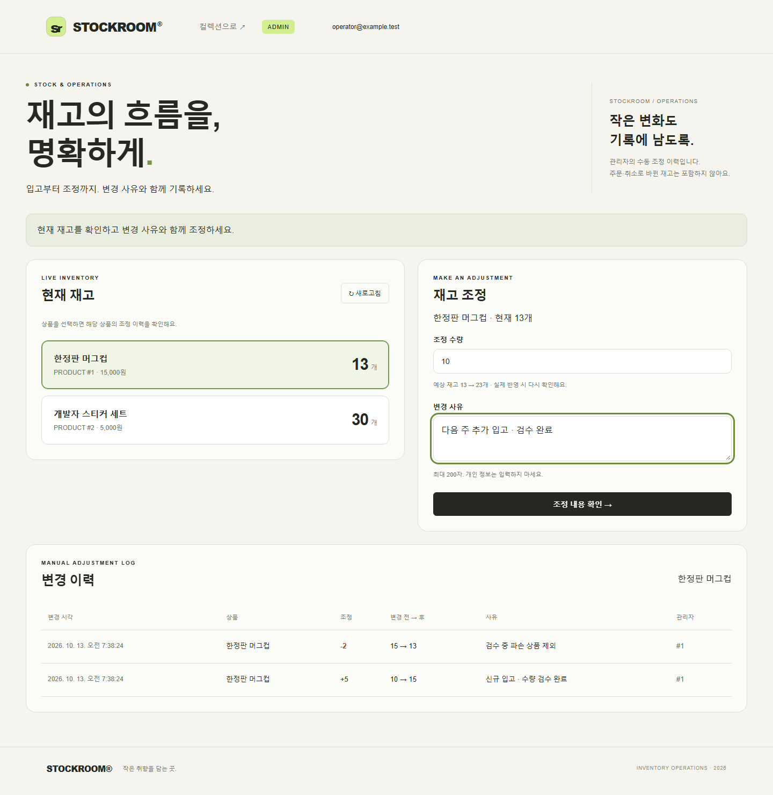

# 관리자 재고 조정과 변경 이력

관리자가 기존 상품의 재고를 증감하고, 실행자·사유·변경 전후 수량을 남깁니다.
`/admin.html`에서 상품 선택 → 수량·사유 입력 → 확인창 → 반영 → 이력 조회 순서로 사용합니다.
양수는 입고, 음수는 폐기·실사 조정 등이며 최종 재고는 `0`~`2147483647`이어야 합니다.
화면의 예상 재고는 참고값이고 실제 변경 전후 수량은 상품 잠금을 획득한 뒤 결정합니다.



## 권한과 로컬 관리자 준비

Flyway V10은 기존 회원과 새 회원에 모두 `USER`를 부여합니다.
회원가입 본문에 `role: ADMIN`을 넣어도 관리자 권한을 얻을 수 없습니다.
`/admin/**`와 `/admin.html`, `/catalog.html`은 관리자 세션만 접근하며, 모든 쓰기에 CSRF 토큰이 필요합니다.
로그인·본인 확인 응답은 `userId`, `email`, `role`을 반환합니다.

먼저 웹 화면에서 본인이 사용할 계정을 등록합니다. Python 3와 Docker를 준비하고 저장소 루트에서 실행합니다.
프로젝트 이름·환경 파일은 실제 로컬 Compose 실행 설정과 일치해야 합니다.

```powershell
$operatorEmail = Read-Host '관리자로 지정할 기존 회원 이메일'
python scripts/set-admin-role.py --project order-stock-service --env-file .env --email $operatorEmail --role ADMIN --confirm-role-change
```

이 도구는 지정한 로컬 Compose의 `order_stock` DB에 운영자 권한으로 접근합니다.
사용자 입력은 UTF-8 hex 리터럴과 이메일 컬럼의 명시적 collation으로 비교하며, 비밀번호를 출력하지 않습니다.
존재하지 않는 계정은 생성하지 않습니다. 공개 권한 변경 API나 기본 관리자 비밀번호는 없습니다.
권한을 올린 뒤 로그아웃·재로그인하면 상단에 **재고 관리**가 표시됩니다.

권한을 회수할 때 같은 명령의 `--role USER`를 사용합니다.
이미 열린 관리자 세션도 각 재고 API 호출 때 현재 DB 권한을 확인하므로 회수 후 새 요청은 `403 ADMIN_REQUIRED`입니다.
권한 확인을 마친 진행 중 트랜잭션까지 소급 취소하는 것은 아닙니다.
다른 운영 DB의 권한 부여는 별도의 운영자 접근·승인 절차로 처리하며 이 로컬 도구의 대상이 아닙니다.

## API와 멱등 요청

| 요청 | 결과 |
|---|---|
| `POST /admin/products/{productId}/inventory-adjustments` | 수동 재고 조정. 신규 201, 같은 요청 재응답 200 |
| `GET /admin/inventory-adjustments?productId=1&beforeId=100` | 최신순 20건과 `nextBeforeId`. 필터·커서는 선택 |

POST 본문은 `{ "delta": 5, "reason": "추가 입고" }`이며 `Idempotency-Key`가 필수입니다.
키는 1~64자, 첫 문자는 영문·숫자, 나머지는 영문·숫자·`.`·`_`·`:`·`-`입니다.
사유는 양끝 공백을 제거하고 1~200자이며 수량은 0이 아닌 32비트 정수입니다.

같은 관리자·키·상품·수량·정규화한 사유는 **최초 이력**을 반환합니다.
그 뒤 다른 작업으로 현재 재고가 바뀌어도 최초의 전후 수량과 시각은 유지됩니다.
`Idempotency-Replayed` 헤더로 재응답 여부를 확인합니다. 같은 키의 내용을 바꾸면 `409 IDEMPOTENCY_KEY_REUSED`입니다.
서로 다른 관리자는 같은 키를 독립적으로 사용할 수 있습니다.

응답에는 `adjustmentId`, `adminId`, `productId`, 당시 `productName`, `delta`, `beforeStock`, `afterStock`, `reason`, UTC `createdAt`이 있습니다.
각 관리자는 전체 관리자의 수동 조정 이력을 조회할 수 있습니다. 사유에 개인 정보나 비밀을 남기지 않습니다.

| 오류 | HTTP |
|---|---|
| 비로그인 / 일반 회원 / 회수된 관리자 | 401 / 403 / 403 |
| CSRF 누락·불일치 | 403 |
| 수량·사유·키·커서 검증 실패 | 400 |
| 존재하지 않는 상품 | 404 |
| 음수 재고·정수 범위 초과 / 다른 내용의 키 재사용 | 409 |

실제 요청·응답 예시는 [테스트에서 생성한 API 가이드](api-documentation.md)의 관리자 재고 절을 참고하세요.

## 정합성과 기록 범위

요청 키 예약 → 같은 키 잠금 → 주문과 같은 상품 행 잠금 → 재고 변경 → 이력 저장 → 요청 완료를 단일 트랜잭션에서 처리합니다.
이력 저장이 실패하면 이미 flush한 재고와 키 예약도 함께 롤백합니다.
같은 키의 재요청은 현재 읽기(`FOR SHARE`)로 최초 이력을 가져옵니다.
권한 조회로 만들어진 MySQL REPEATABLE READ 스냅샷이 다른 요청의 커밋 이전이어도 재응답이 누락되지 않습니다.

이력은 웹 API에서 추가·조회만 가능합니다. DB 운영자의 수정까지 막는 위변조 방지 저장소는 아닙니다.
이 문서의 `inventory_adjustments`는 **수동 조정 전용 이력**입니다.
V11부터 별도 `inventory_movements`에 주문·취소·환불·자동 만료·수동 변경을 기록합니다.
재고 관리 화면에서 전체 원장과 잔액 대조를 조회하고, 상품 관리 화면에서 상품 추가·이름·가격·판매 상태를 변경합니다.
정책과 API는 [상품 관리·전체 재고 원장](catalog-and-ledger.md)을 참고하세요.
이력 수정·삭제, 외부 재고 시스템 동기화는 범위에 포함하지 않습니다.

프론트는 확인 후 POST 전에 회원별 sessionStorage에 수량·사유·요청 키를 저장합니다.
응답 유실·서버 오류 시 입력을 고정하며, 새로고침 후에도 **같은 요청 다시 확인**으로 기존 결과를 조회합니다.
자동 재시도는 하지 않으며 비밀번호·세션 쿠키·CSRF 토큰을 sessionStorage에 넣지 않습니다.
반영 성공 뒤 목록 갱신만 실패한 경우에는 조정 완료를 안내하고 새 조정을 재전송하지 않습니다.

## 검증

- 실제 MySQL 통합 테스트 19개: 권한 상승 차단, 현재 권한 확인, CSRF, 전후 수량·사유·시각, 잘못된 값, 범위 초과, 페이지 조회.
- 같은 키 12건 동시 요청의 재고·이력 1회 반영, 관리자 조정과 주문이 섞인 20건 동시 요청.
- 실제 재고 flush 뒤 이력 실패·바깥 트랜잭션 실패의 재고·이력·키 전체 롤백.
- 관리자 REST Docs 계약 테스트 1개: 신규 조정·재응답·필터 조회·일반 회원 차단.
- 데스크톱·모바일 브라우저 8개: 일반 회원 차단, 확인창 취소·반영·사유 문자열 안전 표시, 응답 유실 후 새로고침·동일 키 재확인, 열린 세션의 권한 회수.
- 기존 V8 DB 업그레이드 CI에서 V9·V10·V11 적용, 기존 회원 USER, 초기 수동 조정 이력 없음, 상품 판매 상태·수정 버전과 기준 원장 잔액, 기존 주문·재고 보존을 확인합니다.
