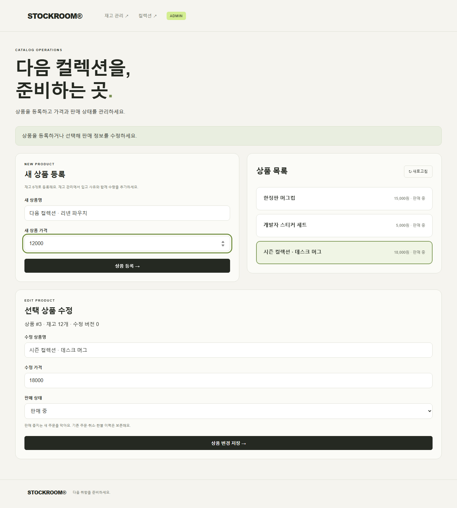
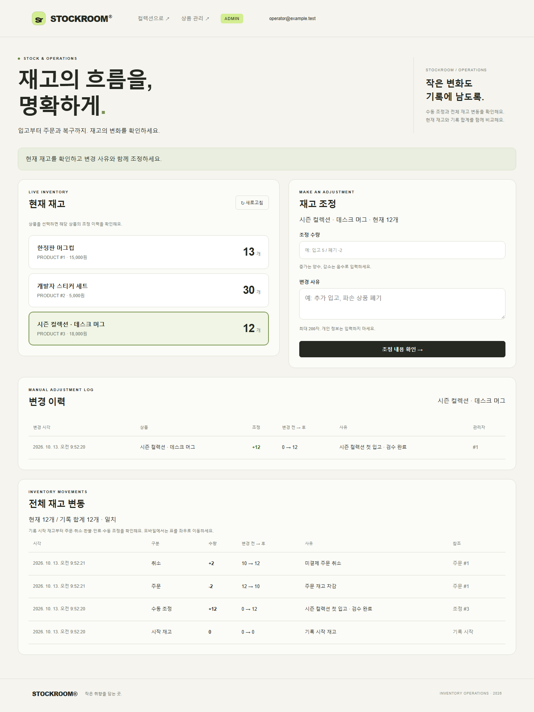

# 상품 운영과 전체 재고 변동

관리자 `/catalog.html`에서 상품을 등록하고 이름·가격·판매 여부를 수정합니다.
기존 `/admin.html`에는 전체 재고 변동과 현재 수량 대조를 추가했습니다.
두 화면과 API는 관리자 세션·CSRF·현재 DB 역할 검증을 사용합니다.
권한 준비는 [관리자 안내](admin-inventory.md)를 참고하세요.

## 상품 등록과 수정

| 요청 | 동작 |
|---|---|
| `GET /admin/products` | 판매 중지 상품을 포함한 목록. 현재 규모에서는 전체 목록 |
| `POST /admin/products` | `{name, price}`와 필수 `Idempotency-Key`. 새 상품은 재고 0·판매 중·revision 0 |
| `PUT /admin/products/{id}` | `{name, price, selling, revision}`. 조회 당시 수정 버전 필요 |
| `GET /products` | 판매 중인 상품만 공개. 재고 0인 품절 상품은 표시 |

상품명은 양끝 공백 제거 후 1~100자, 등록·수정 가격은 0~1000000000000원 정수입니다.
등록 요청 키는 관리자별이며 형식은 기존 재고 조정 키와 같습니다.
같은 키·같은 등록 내용은 최초 `productId`를 반환합니다(신규 201, 재응답 200).
상품을 나중에 수정해도 재등록하지 않습니다. 다른 내용의 키 재사용은 409입니다.
등록 요청과 새 상품·재고 시작점은 한 트랜잭션이며, 화면도 응답 유실 뒤 새로고침해 같은 키로 재확인합니다.

수정은 상품 행을 잠그고 `revision`을 확인합니다. 오래된 화면은 `409 CATALOG_CHANGED`로 덮어쓰기를 막습니다.
재고 변경은 상품 정보 수정 버전을 올리지 않으며 입고·폐기는 기존 재고 조정 API로 수행합니다.
수정 응답이 불확실하면 목록을 새로고침해 현재 값을 확인하세요. 이전 revision 재전송은 조용히 덮어쓰지 않습니다.

`selling=false`는 공개 목록과 **새 주문**을 차단합니다(`409 PRODUCT_NOT_SELLING`).
이미 생성한 주문의 상품명·가격은 보존하며 결제·취소·환불·자동 만료 정책은 계속 적용합니다.
중지와 새 주문은 같은 상품 잠금으로 순서가 결정됩니다. 중지 커밋 이전에 승인된 주문을 소급 취소하지 않습니다.
재판매는 같은 상품의 `selling=true` 수정입니다. 상품 삭제·이미지 업로드·검색·카테고리·상품 수정 감사 이력은 별도 범위입니다.

## 원장 시작점과 이동 종류

V11은 기존 상품의 **마이그레이션 당시 현재 재고**를 BASELINE으로 기록합니다.
이전 주문이나 수동 조정 기록을 소급 복원하지 않습니다. 이전 수동 조정 이력은 기존 화면/API에서 유지합니다.
신규 상품의 시작점은 0입니다. 애플리케이션 경로의 이후 재고 변경은 아래 종류로 기록됩니다.

| 종류 | 수량 | 참조 |
|---|---:|---|
| BASELINE | 시작 수량 | `opening` |
| ORDER | -주문 수량 | 주문 ID |
| CANCEL | +취소 수량 | 주문 ID |
| REFUND | +전액 환불 수량 | 주문 ID |
| EXPIRE | +자동 만료 수량 | 주문 ID, 실행자 null |
| MANUAL | 관리자 증감 수량 | 수동 조정 ID |

변동에는 당시 상품명·전후 수량·사유·실행자·UTC 시각을 보관합니다.
결제는 이미 예약한 재고를 추가 차감하지 않습니다. 실패한 결제·환불과 재응답·반복 상태 전이는 추가 변동을 만들지 않습니다.
`(product_id, movement_type, event_reference)` 유니크 제약으로 같은 원인의 이중 기록도 거부합니다.
주문·재고·원장 기록은 같은 트랜잭션입니다. 원장 SQL 실행 후 실패하더라도 주문 상태와 재고를 모두 롤백합니다.

`GET /admin/inventory-movements?productId=1&beforeId=100`은 최신순 최대 20건·다음 커서와
`currentStock`, `recordedStock`, `consistent`를 반환합니다. `recordedStock`은 페이지와 관계없는 전체 증감 합계입니다.
현재 재고와 합계는 하나의 읽기 트랜잭션에서 대조합니다. 관리자 화면의 새로고침으로 다시 확인할 수 있습니다.
웹 API에 이력 수정·삭제는 없습니다. 운영자 SQL 직접 변경은 원장에 남지 않으며 수량 불일치를 감지할 수 있습니다.
이 기능은 DB 운영자의 기록 변조까지 막는 저장소가 아니며 불일치를 자동 보정하지 않습니다.

## 검증

실제 MySQL에서 등록 동시 요청·재응답, 수정 충돌, 판매 중지·재개, 주문 당시 이름·가격 보존,
판매 중지 후 기존 주문 취소·환불, 전체 이동 종류·재응답, 커서와 전체 잔액, DB 직접 변경 감지를 검증합니다.
주문·취소·환불·만료 각각에서 실제 원장 SQL 이후 오류를 만들어 상태·재고·원장의 전체 롤백을 확인합니다.
브라우저는 데스크톱·모바일에서 등록·판매 중지·원장 표시, 등록 응답 유실 후 새로고침·같은 키 재확인,
두 수정 화면의 충돌·새로고침 복구를 검증합니다. V8 업그레이드 CI는 V11 판매 상태·시작 재고와 이후 만료의 잔액도 확인합니다.
