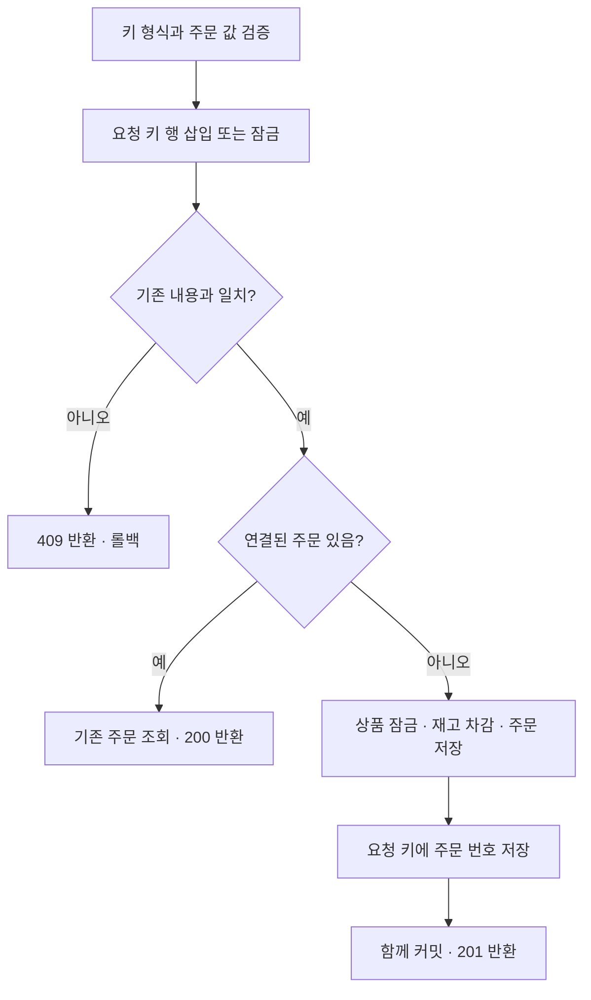

# 주문 생성 요청의 중복 방지

주문 버튼을 두 번 누르거나 응답을 받지 못해 재시도할 때, 같은 요청 키를 사용하면 주문을 한 개만 만듭니다.
현재 단일 상품 주문의 내용은 `productId`와 `quantity`로 비교합니다.

## 직접 실습

상품 ID와 재고를 먼저 확인한 뒤 PowerShell에서 실행합니다.
먼저 [인증 실습](auth.md)의 1~3번으로 로그인하고 같은 터미널의 `$session`을 사용하세요.

```powershell
Invoke-RestMethod 'http://localhost:8080/products' | Format-Table
$requestKey = [Guid]::NewGuid().ToString()
$headers = @{ 'Idempotency-Key' = $requestKey }
$csrf = Invoke-RestMethod 'http://localhost:8080/auth/csrf' -WebSession $session
$headers[$csrf.headerName] = $csrf.token
$body = '{"productId":1,"quantity":2}'

$first = Invoke-RestMethod -Method Post -Uri 'http://localhost:8080/orders' `
  -WebSession $session -Headers $headers -ContentType 'application/json' -Body $body
$retry = Invoke-RestMethod -Method Post -Uri 'http://localhost:8080/orders' `
  -WebSession $session -Headers $headers -ContentType 'application/json' -Body $body

$first.orderId
$retry.orderId
Invoke-RestMethod 'http://localhost:8080/products' | Format-Table
```

두 응답의 주문 번호가 같으며 재고는 총 2개만 줄어듭니다.
새 주문을 의도할 때만 새 UUID를 발급합니다. 재시도할 때 키를 바꾸면 별도 주문이 됩니다.
서버 재시작 후에도 같은 키와 내용으로 재요청하면 기존 주문을 반환합니다.

## API 계약

| 상황 | HTTP | 응답 |
|---|---|---|
| 새 키 + 정상 주문 | 201 | 새 주문, `Idempotency-Replayed: false` |
| 기존 키 + 같은 상품·수량 | 200 | 기존 주문, `Idempotency-Replayed: true` |
| 기존 키 + 다른 상품 또는 수량 | 409 | `IDEMPOTENCY_KEY_REUSED` |
| 잘못된 키 형식 | 400 | `INVALID_IDEMPOTENCY_KEY` |
| 키 생략 | 201 | 기존 방식으로 매번 새 주문 생성 |

성공 응답에는 `Location: /orders/{orderId}`가 포함됩니다.
키는 영문·숫자로 시작하는 1~64자의 영문·숫자·점·밑줄·콜론·하이픈만 허용합니다.
대소문자를 구분하고 공백은 허용하지 않습니다. UUID 문자열을 사용하면 됩니다.
키는 만료 없이 DB에 보관하며 로그인한 회원 ID와 함께 구분합니다.
다른 회원이 같은 키를 사용해도 서로 별도의 주문을 생성하며 타인의 주문을 반환하지 않습니다.

재고 부족 등 실패한 요청은 키도 저장하지 않습니다. 재입고 후 같은 키와 내용으로 다시 주문할 수 있습니다.
취소된 주문의 키를 재사용하면 기존 주문의 현재 상태인 `CANCELLED`를 반환하고 재고를 다시 차감하지 않습니다.
이 API는 최초 응답 본문을 캐시하지 않고 기존 주문의 현재 상태를 반환합니다.
결제 후에는 현재 상태 `PAID`, 환불 후에는 `REFUNDED`를 반환합니다. 결제 API의 키는 주문별로 구분하며
원래 결제 이력을 반환하므로 [결제 요청 계약](payments.md)을 별도로 참고하세요.
환불도 별도의 주문별 키로 최초 환불 이력을 반환합니다. [환불 요청 계약](refunds.md)을 참고하세요.

## 트랜잭션 흐름



`IdempotentOrderService`의 트랜잭션에 JDBC 요청 키 저장과 JPA 주문 저장이 함께 참여합니다.
`order_requests`의 `(user_id, request_key)` 유니크 키와 MySQL의 `INSERT ... ON DUPLICATE KEY UPDATE`를 사용해
같은 키의 요청이 동시에 실행돼도 하나씩 처리합니다. 기존 요청 내용은 덮어쓰지 않습니다.
어느 단계에서든 실패하면 키·주문·재고가 함께 롤백됩니다.
따라서 별도 메모리 캐시나 단일 서버의 잠금에 의존하지 않습니다.

공식 문서: [MySQL 중복 키 처리](https://dev.mysql.com/doc/refman/8.4/en/insert-on-duplicate.html),
[Spring 트랜잭션](https://docs.spring.io/spring-framework/reference/data-access/transaction/declarative/tx-decl-explained.html).

## 검증과 다음 단계

실제 MySQL에서 같은 키의 동시 요청 20건이 주문 한 개만 생성하는지 검증합니다.
다른 내용의 키 재사용, 다른 키의 동시 요청, 실패 후 재시도, 키 완료 저장 실패의 전체 롤백,
취소 후 재요청, 상품 가격 변경 후 재요청도 테스트합니다.

회원 인증과 주문 소유자 확인을 적용했습니다. [모의 결제](payments.md)에도 중복 요청 방지를 적용했습니다.
