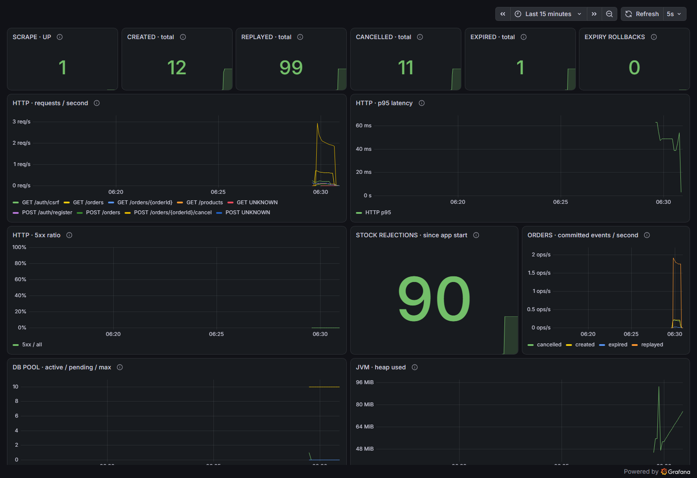

# 주문 처리와 실행 상태 모니터링

Micrometer → Prometheus → Grafana로 주문 처리, HTTP 지연, JVM과 DB 연결 풀을 관측합니다.
`monitoring/compose.observability.yaml`은 **로컬 데모용** 오버레이입니다. 공개 배포 구성과 별개입니다.



## 실행

Docker Desktop을 실행한 뒤 저장소 루트에서 아래 PowerShell 명령을 실행합니다.
기존 실습 DB와 분리된 `order-stock-monitor-local` 프로젝트와 앱 18086 포트를 사용합니다.
비밀 파일이 이미 있으면 새로 만들지 말고 다음 실행 명령부터 사용하세요.

```powershell
New-Item -ItemType Directory -Force .local | Out-Null
$monitorEnv = '.local/monitoring.env'
if (Test-Path -LiteralPath $monitorEnv) { throw '기존 환경 파일을 보존하세요.' }
function New-MonitorPassword {
    $bytes = [byte[]]::new(24)
    $rng = [Security.Cryptography.RandomNumberGenerator]::Create()
    try { $rng.GetBytes($bytes) } finally { $rng.Dispose() }
    return -join ($bytes | ForEach-Object { $_.ToString('x2') })
}
$lines = @(
    'APP_PORT=18086'
    "MYSQL_PASSWORD=$(New-MonitorPassword)"
    "MYSQL_ROOT_PASSWORD=$(New-MonitorPassword)"
    "GRAFANA_ADMIN_PASSWORD=$(New-MonitorPassword)"
)
[IO.File]::WriteAllLines((Join-Path (Get-Location) $monitorEnv), $lines, [Text.UTF8Encoding]::new($false))

docker compose -p order-stock-monitor-local --env-file .local/monitoring.env -f compose.yaml -f monitoring/compose.observability.yaml up --build --wait --wait-timeout 240
```

- 앱: [localhost:18086](http://localhost:18086/)
- Grafana: [STOCKROOM 대시보드](http://localhost:13000/d/stockroom)
- Prometheus: [localhost:19090](http://localhost:19090/)

Grafana는 로그인 없이 **Viewer**로 조회합니다. 관리자는 `monitor-admin`이며 비밀번호는 방금 만든 개인 환경 파일에만 보관합니다.
파일·값을 Git이나 이슈에 첨부하지 않습니다. Grafana·Prometheus는 호스트의 `127.0.0.1`에만 연결하고,
앱 관리 포트 9091은 호스트에 게시하지 않습니다. 앱과 수집기를 연결하는 내부 네트워크에서만 사용합니다.
기본 앱 포트의 `/actuator/prometheus`는 로그인 여부와 관계없이 403입니다.
Prometheus·Grafana는 DB 네트워크에 참여하지 않습니다.

관측 프로필에서는 health도 관리 포트로 이동하므로 앱 컨테이너의 readiness 점검을 9091로 바꿉니다.
기존 `local`·`prod` 구성의 health와 포트 설정은 유지됩니다.
프록시의 `X-Forwarded-Port`만 바꾸어 관리 포트 권한을 얻을 수 없도록 실제 로컬 포트도 검증합니다.

중지 후 다시 시작하면 DB·Grafana·Prometheus 볼륨이 유지됩니다.

```powershell
docker compose -p order-stock-monitor-local --env-file .local/monitoring.env -f compose.yaml -f monitoring/compose.observability.yaml down
```

## 지표의 의미

| Prometheus 지표 | 의미 |
|---|---|
| `stockroom_order_events_total{outcome="created"}` | 주문 생성 트랜잭션이 커밋된 횟수 |
| `stockroom_order_events_total{outcome="replayed"}` | 동일 주문을 성공적으로 재응답하고 트랜잭션이 커밋된 횟수 |
| `stockroom_order_events_total{outcome="cancelled"}` | 최초 수동 취소가 커밋된 횟수; 반복 취소·환불 제외 |
| `stockroom_order_events_total{outcome="expired"}` | 자동 만료와 재고 복구가 커밋된 횟수 |
| `stockroom_order_rejections_total{reason="insufficient_stock"}` | 재고 부족으로 거절한 HTTP 응답 수; 다른 409·인증·입력 오류 제외 |
| `stockroom_expiration_failures_total` | 만료 처리 트랜잭션이 롤백된 횟수; 다음 주기에 재시도 |
| `http_server_requests_seconds_*` | 정규화된 URI별 요청 수·지연; histogram 활성화 |
| `hikaricp_connections_*`, `jvm_memory_used_bytes` | DB 연결 풀과 JVM 메모리 |

성공 지표는 `TransactionSynchronization.afterCommit`에서 증가합니다.
SQL flush가 성공해도 외부 트랜잭션에서 롤백되면 집계하지 않습니다.
멱등 재응답은 새 주문과 분리하고 반복 취소·이미 처리된 만료 후보는 추가 집계하지 않습니다.
만료 실패는 `afterCompletion(ROLLED_BACK)`에서 기록합니다.
지표 갱신 예외가 이미 커밋된 주문의 응답을 실패로 바꾸지 않도록 처리합니다.

라벨은 고정된 outcome/reason과 프레임워크의 정규화된 HTTP 경로입니다.
회원·주문·상품 ID, 이메일, 멱등 키, 원본 URL은 커스텀 라벨에 넣지 않습니다.
DB 전체 주문 수가 아닌 **프로세스 실행 이후의 이벤트**이며 재시작 때 카운터가 0으로 초기화됩니다.
커밋 직후 프로세스가 종료되거나 scrape 전에 재시작되면 일부 이벤트가 유실될 수 있으므로 회계·감사 장부로 사용하지 않습니다.
변화량은 `rate()`/`increase()`로 보고, 내구성이 필요한 이력은 DB를 조회합니다.

## 대시보드 읽기

13개 패널에서 scrape 상태, 주문 결과, 재고 부족, 만료 롤백, HTTP 처리량·p95·5xx 비율, DB 풀, JVM heap을 확인합니다.
HTTP 409 재고 부족은 예상 도메인 응답이며 5xx 비율에 넣지 않습니다.
5초마다 수집하고 1분 구간 `rate()`를 계산합니다. 요청이 없으면 p95가 비어 있거나 NaN일 수 있습니다.
히스토그램은 1ms~5s 범위의 버킷을 사용하며 p95는 근사값입니다.
서버 p95는 인증·조회까지 포함한 전체 경로이고 클라이언트 부하 도구의 주문별 p95와 측정 범위가 다릅니다.
앱 시작 직후 처음 생성된 HTTP 시계열은 첫 scrape 이전 요청이 `rate()` 계산에 누락될 수 있습니다.
짧은 최초 부하의 지연은 클라이언트 리포트로 확인하고, 서버 지표의 성능 비교는 응답 유형별 예열과 지속·반복 트래픽을 사용합니다.
낮은 트래픽의 짧은 데모 결과를 운영 용량으로 해석하지 않습니다.

Prometheus 원본 샘플은 최대 24시간·256MB로 제한합니다. 알림 전송, 장기 저장, 실제 서버 장애 대응은 아직 포함하지 않습니다.
만료 롤백 카운터는 개별 만료 트랜잭션만 다루며 후보 조회 실패·스케줄러 중단 전체를 탐지하지 않습니다.

## 자동 검증

[Observability CI](https://github.com/zeroziba9-hash/order-stock-service/actions/workflows/observability.yml)는
전용 프로젝트 `order-stock-load-monitor-ci`와 새 DB를 만들고 종료 시 해당 볼륨만 삭제합니다.
로컬의 기존 앱·DB로 부하 검증을 실행하지 않습니다.

1. `promtool check config`와 관리 포트 scrape 성공을 확인합니다.
2. 기존 `load-orders.py`의 동시성 32·100회 요청을 실행합니다.
3. 신규 생성 11, 재응답 99, 최초 취소 11, 재고 부족 90을 Prometheus에서 DB 결과와 대조합니다.
4. 새 미결제 주문 한 건을 만들고 **그 전용 DB의 해당 주문만** UTC 기준 만료 기한을 과거로 조정합니다.
5. 실제 스케줄러가 상태를 EXPIRED로 바꾸고 생성 12·만료 1, 최종 재고 10이 되는지 확인합니다.
6. 13개 패널의 PromQL, HTTP 히스토그램, JVM·Hikari, Grafana의 데이터 소스 연결과 Viewer 권한을 확인합니다.

CI에서만 스케줄러 점검 간격을 1초로 줄이며 기본은 60초입니다. 결제 기한 30분은 그대로 둡니다.
`verify-observability.py`는 `LOAD_DISPOSABLE=true`, 프로젝트 이름 접두사, 전용 DB 이름, 부하 결과 11건을 확인한 뒤에만 fixture를 씁니다. 이미 검증 주문까지 만료된 12건 상태에서는 읽기만 재검증합니다.
리포트에는 집계 수·지연만 남기고 계정·세션·키·비밀번호를 저장하지 않습니다.

백엔드 통합 테스트는 flush 이후 롤백, 외부 트랜잭션의 재응답·취소 롤백, 동시 동일 키,
만료 쓰기 실패 후 재시도, 재고 부족 응답 구분, 별도 실제 HTTP 포트의 접근 제한을 검증합니다.

## 참고

- [Spring Boot: Metrics](https://docs.spring.io/spring-boot/4.0/reference/actuator/metrics.html)
- [Spring Boot: Monitoring over HTTP](https://docs.spring.io/spring-boot/4.0/reference/actuator/monitoring.html)
- [Prometheus 다운로드·LTS](https://prometheus.io/download/)
- [Grafana 파일 provisioning](https://grafana.com/docs/grafana/latest/administration/provisioning/)
