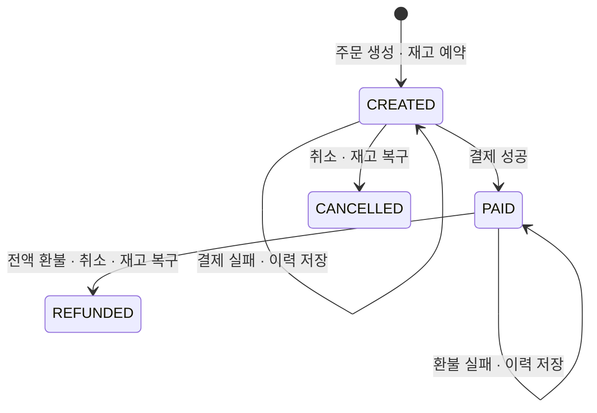

# 모의 결제 실습

실제 결제사 호출이나 돈의 이동 없이 결제 성공·실패, 중복 요청, 주문 상태 전이를 실습합니다.
`result`를 사용자가 선택하는 로컬 학습용 API이므로 공개 서비스의 실제 결제로 사용하면 안 됩니다.
아래 실습은 기본 `local` 프로필용입니다. `prod`에서는 모의 결제 POST를 `404 MOCK_API_DISABLED`로 차단하고 본인 이력 조회는 유지합니다.

## 상태와 재고



`PAID`·`CANCELLED`·`REFUNDED`에서 새 결제는 거부합니다.
`PAID` 주문의 `/cancel`은 거부하고, [환불 API](refunds.md)에서 환불과 취소를 함께 처리합니다.
결제 자체는 재고를 변경하지 않습니다. 실패해도 재고는 예약 상태이며, 포기하려면 주문을 취소하세요.
현재 자동 만료는 없습니다. 생성·결제·취소 시각은 모두 UTC로 저장하고 API는 `Z`가 붙은 시각으로 반환합니다.

## 1. 로그인하고 새 주문 생성

[인증 실습](auth.md)의 1~3번으로 로그인한 같은 PowerShell 터미널에서 실행합니다.
`$session`과 로그인 후 갱신한 `$headers`가 필요합니다. 상품 ID와 재고를 먼저 확인하세요.

```powershell
$base = 'http://localhost:8080'
Invoke-RestMethod "$base/products" | Format-Table
$headers['Idempotency-Key'] = [Guid]::NewGuid().ToString()
$order = Invoke-RestMethod -Method Post -Uri "$base/orders" -WebSession $session `
  -Headers $headers -ContentType 'application/json' -Body '{"productId":1,"quantity":1}'
$paymentUrl = "$base/orders/$($order.orderId)/payments"
```

## 2. 실패와 같은 요청의 재시도

```powershell
$headers['Idempotency-Key'] = [Guid]::NewGuid().ToString()
$failed = Invoke-RestMethod -Method Post -Uri $paymentUrl -WebSession $session `
  -Headers $headers -ContentType 'application/json' -Body '{"result":"FAILURE"}'
$failed

# 같은 키와 내용으로 다시 보내면 같은 paymentId와 최초 실패 이력을 반환합니다.
Invoke-RestMethod -Method Post -Uri $paymentUrl -WebSession $session `
  -Headers $headers -ContentType 'application/json' -Body '{"result":"FAILURE"}'
```

새 결제 시도는 성공·실패 모두 `201 Created`입니다. 이는 결제 이력이 생성됐다는 뜻입니다.
결제 승인 여부는 본문의 `status` (`SUCCEEDED` 또는 `FAILED`)로 확인하세요.
실패 결과를 저장하기 위해 업무상 거절을 예외로 던지지 않고 정상 커밋합니다.
동일 요청 재시도는 `200 OK`, `Idempotency-Replayed: true`이고 추가 이력이 생기지 않습니다.

## 3. 새 키로 성공시키기

```powershell
$headers['Idempotency-Key'] = [Guid]::NewGuid().ToString()
$paid = Invoke-RestMethod -Method Post -Uri $paymentUrl -WebSession $session `
  -Headers $headers -ContentType 'application/json' -Body '{"result":"SUCCESS"}'
$paid
Invoke-RestMethod "$base/orders/$($order.orderId)" -WebSession $session | ConvertTo-Json -Depth 5
Invoke-RestMethod $paymentUrl -WebSession $session | Format-Table

# 응답을 받지 못했을 때처럼 같은 키로 재시도: 원래 성공 이력을 반환합니다.
Invoke-RestMethod -Method Post -Uri $paymentUrl -WebSession $session `
  -Headers $headers -ContentType 'application/json' -Body '{"result":"SUCCESS"}'
```

예를 들어 주문 총액이 15,000원이면 다음 형태의 결제 응답을 반환합니다. ID와 시각은 예시입니다.

```json
{
  "paymentId": 2,
  "orderId": 1,
  "amount": 15000,
  "status": "SUCCEEDED",
  "createdAt": "2026-10-12T06:00:00Z"
}
```

주문은 `PAID`로 바뀌고 `paidAt`은 성공 결제 시각과 같습니다. 요청으로 금액을 지정할 수 없습니다.
이후 상품 가격이 바뀌어도 주문 당시 총액을 사용합니다. 이력 조회는 ID 오름차순이며 없는 이력은 `[]`입니다.

## API 계약

| 상황 | HTTP | 결과 |
|---|---|---|
| 새 키 + 결제 대기 주문 + `SUCCESS` | 201 | `SUCCEEDED`, 주문 `PAID` |
| 새 키 + 결제 대기 주문 + `FAILURE` | 201 | `FAILED`, 주문 `CREATED` 유지 |
| 같은 키 + 같은 결과 선택 | 200 | 최초 결제 이력, `Idempotency-Replayed: true` |
| 같은 키 + 다른 결과 선택 | 409 | `IDEMPOTENCY_KEY_REUSED` |
| 결제·취소·환불 완료 주문에 새 키 | 409 | `ORDER_NOT_PAYABLE` |
| 결제 완료 주문에 `/cancel` 요청 | 409 | `REFUND_REQUIRED` — 환불 API 사용 |
| 결제 키 누락·잘못된 형식 | 400 | `INVALID_IDEMPOTENCY_KEY` |
| `result` 누락·잘못된 값·숫자 | 400 | `INVALID_REQUEST` |
| 없는 주문 또는 다른 회원의 주문 | 404 | `ORDER_NOT_FOUND` |
| 로그인 필요 / CSRF 오류 | 401 / 403 | `AUTH_REQUIRED` / `ACCESS_DENIED` |
| 잠금 충돌·대기 시간 초과 | 409 | `ORDER_CONFLICT` |

새 요청에는 `Idempotency-Replayed: false`를 반환합니다. `Location`은 해당 주문의 결제 이력 URL입니다.
`Idempotency-Key`는 필수이며 영문·숫자로 시작하는 1~64자의 영문·숫자·`._:-` 조합입니다.
대소문자를 구분하고 주문별로 보관합니다. 주문 생성 키와 결제 키는 별개이며 만료하지 않습니다.
서버 재시작 뒤에도 이력과 키가 남습니다. 세션은 사라지므로 다시 로그인한 후 재시도하세요.

주문 생성 키의 재시도는 주문의 **현재 상태**를 반환합니다. 결제 키의 재시도는 **최초 결제 이력**을 반환합니다.
따라서 실패 후 주문을 취소하거나 다른 키로 결제에 성공해도 이전 실패 키는 계속 `FAILED`를 반환합니다.
현재 주문 상태를 확인하려면 `GET /orders/{orderId}`를 사용하세요.
환불을 완료한 뒤에도 원래 성공 결제 키는 최초 `SUCCEEDED` 이력을 반환합니다.
이는 승인 이력이며 현재 환불 여부를 나타내지 않습니다. 주문 상태와 환불 이력을 함께 확인하세요.

## 잠금과 검증

결제와 취소 모두 소유자 조건으로 주문 행을 먼저 잠급니다. 같은 주문의 다른 키도 순서대로 처리하므로
결제와 취소 중 먼저 커밋한 쪽에 따라 다음 요청이 거부됩니다. 결제 결과 저장과 `PAID` 전이는 같은 트랜잭션입니다.
DB 저장 오류는 이력과 상태를 모두 롤백하고, 같은 키로 다시 시도할 수 있습니다.
DB에서도 `(order_id, request_key)` 유니크 키와 성공 상태에만 값이 생기는 생성 열의 유니크 키로 중복을 막습니다.

실제 MySQL 테스트에서 승인·거절, 금액 고정, 소유자·CSRF, 재시도, 동시 결제 20건,
결제·취소 경쟁, 실제 SQL 쓰기 후 오류의 전체 롤백을 검증합니다.
숫자를 enum 순번으로 받지 않는 설정은 [Spring Boot의 Jackson 설정](https://docs.spring.io/spring-boot/4.0/how-to/spring-mvc.html)을 따릅니다.

이 방식의 원자성은 같은 DB 안의 모의 결제에 한정됩니다. 실제 결제사는 DB 롤백으로 결제를 취소할 수 없으므로
외부 호출 중 DB 잠금을 오래 잡는 대신 승인 대기 상태, 결제사 멱등 키, 웹훅 검증과 결과 대조·복구를 별도로 설계해야 합니다.
결제 완료 주문을 취소하려면 [모의 환불 실습](refunds.md)을 이어서 실행하세요.
