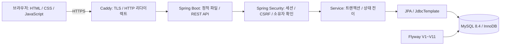
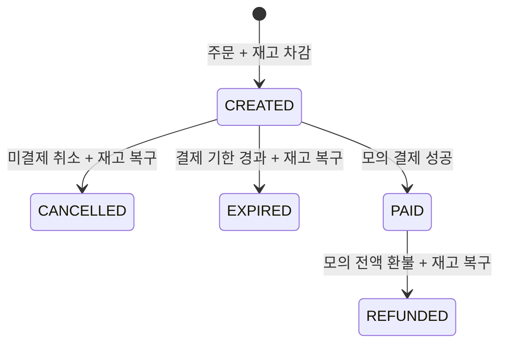

# STOCKROOM 설계와 검증 기록

## 프로젝트 목적과 범위

한정 수량 상품을 여러 회원이 동시에 주문할 때 초과 판매를 막고,
응답을 받지 못해 재시도해도 주문이 중복 생성되지 않도록 구현한 Java/Spring 백엔드 포트폴리오입니다.
회원가입·상품·주문·모의 결제·모의 환불을 웹 화면에서 직접 체험하고 실제 MySQL 결과로 검증합니다.

구현 범위는 단일 상품 주문·전액 모의 환불·단일 앱 인스턴스입니다.
실제 PG·배송·장바구니·분산 세션은 포함하지 않습니다. 관리자 상품 등록·수정·판매 중지와 전체 재고 이동 원장을 제공합니다.
2026-10-13 기준 공개 서버·도메인은 연결하지 않았으며 공개 배포 완료로 기재하지 않습니다.

## 아키텍처

로컬 Compose는 앱의 18080 포트로 접속합니다. 운영 Compose는 Caddy의 80·443만 공개하고 앱·DB를 내부 네트워크에 둡니다.
같은 출처에서 정적 프론트와 API를 제공해 별도의 프론트 배포나 교차 출처 인증 설정 없이 세션 로그인을 사용합니다.
핵심 테이블은 `products`, `app_users`, `purchase_orders`, `order_items`, `order_requests`,
`payment_attempts`, `refund_attempts`, `inventory_adjustments`, `inventory_adjustment_requests`,
`inventory_movements`, `catalog_creation_requests`입니다.
주문 항목은 당시 상품명·가격을, 수동 조정은 실행자·사유·당시 상품명·변경 전후 수량을 보관합니다.

## 설계 선택

### 주문과 재고를 한 트랜잭션에서 처리

[OrderService](../src/main/java/com/zeroziba/orderstock/order/OrderService.java)는 상품 행을 비관적 쓰기 잠금으로 읽고
수량·금액을 확인한 뒤 재고 차감과 주문 저장을 수행합니다. 저장 실패가 전파되면 둘 다 롤백합니다.
DB의 음수 재고·가격 제약도 둡니다. JVM 내부 잠금에 의존하지 않고 DB의 동시 쓰기를 제어합니다.

장점은 상품 단위 정합성 흐름을 명확하게 읽을 수 있다는 점입니다. 같은 상품에 요청이 몰리면 잠금 대기가 생깁니다.
조건부 UPDATE와의 비교는 [반복 측정](paired-benchmark.md)에 기록합니다. 실험 방식도 상품 정보·원장 전후 수량을 위한 잠금 조회를 유지하며 기본 방식은 행 잠금입니다. 낙관적 잠금 비교는 포함하지 않습니다.

### 응답 유실 뒤 재요청을 기존 주문에 연결

[IdempotentOrderService](../src/main/java/com/zeroziba/orderstock/order/IdempotentOrderService.java)는
회원 ID와 요청 키를 기준으로 DB 행을 예약·잠급니다. 같은 키와 같은 상품·수량이면 기존 주문을 반환하고,
다른 내용으로 재사용하면 `409`를 반환합니다. 키 기록·주문·재고는 같은 트랜잭션에 참여합니다.
키를 생략한 주문은 요청마다 새로 생성되므로 프론트는 응답이 불확실한 재시도에 같은 키를 사용합니다.

키와 요청 정보는 회원별 sessionStorage에 저장하며 비밀번호나 인증 토큰은 저장하지 않습니다.
이 보장은 이 서비스의 DB 주문 생성 범위입니다. 외부 결제사의 승인까지 exactly-once로 보장한다는 의미는 아닙니다.

### 주문 상태로 취소·환불을 제어

취소·결제·환불은 주문 행을 잠근 뒤 상태를 확인합니다. 반복 취소는 최초 결과를 반환하고 재고를 다시 더하지 않습니다.
모의 결제·환불 실패는 시도 이력을 남기되 주문 상태를 유지합니다.
DB 유니크 제약은 주문당 성공 결제·성공 환불을 각각 최대 한 건으로 제한합니다.
운영에서는 모의 결제·환불 쓰기를 비활성화하고 기존 본인 이력 조회만 제공합니다.
미결제 주문은 기본 30분 뒤 자동 만료 대상이 됩니다. [배치·경쟁·재시도 설계](order-expiration.md)를 참고하세요.

### 세션과 소유자 확인

BCrypt 비밀번호, 로그인 시 세션 ID 교체, 쓰기 요청의 CSRF 검증을 사용합니다.
주문·이력 조회는 로그인한 회원의 소유자 조건으로 조회합니다. 타인 주문은 `404`, 비로그인은 `401`입니다.
운영 세션 쿠키는 Secure·HttpOnly·SameSite=Lax입니다. 메모리 세션이므로 앱 재시작 뒤 재로그인이 필요합니다.
운영 설정은 DB 연결·Flyway 이전에 검사하며 root DB 계정·잘못된 프로필 조합·모의 쓰기 허용을 거부합니다.

### 관리자 조정도 주문과 같은 상품 잠금 사용

관리자 API는 세션 역할과 현재 DB 역할을 확인하고 수동 증감만 허용합니다.
관리자별 필수 요청 키·재고·이력은 같은 트랜잭션으로 저장해 중복 입고와 기록 없는 변경을 막습니다.
권한 회수는 이미 열린 세션의 다음 API 요청에도 적용됩니다. 가입으로 권한을 올릴 수 없습니다.
수동 조정 전용 이력과 별도로 [전체 재고 원장](catalog-and-ledger.md)에 주문·취소·환불·만료·수동 변경을 같은 트랜잭션으로 기록합니다.
원장 실패 시 상태·재고·기록이 함께 롤백합니다. V11 적용 시점의 기준 재고를 시작점으로 사용하며 과거 이동을 역산하지 않습니다.
상품별 전체 원장 합계와 현재 재고를 같은 MySQL 스냅샷에서 비교합니다.
상품 등록은 0개로 시작해 입고를 따로 기록하고, 수정 버전으로 오래된 화면의 덮어쓰기를 차단합니다.
판매 중지 뒤에도 과거 주문 항목의 이름·가격과 취소·환불·만료 흐름을 보존합니다.

## 확인한 결과

인증은 [요청 제한](auth-limits.md)을 적용합니다. IP별 전체 한도와 IP+계정 실패 한도를 구분하고
동시 비밀번호 검사도 슬롯에 포함합니다. 계정 전역 잠금에 따른 타인의 로그인 방해를 피하면서 이메일 변경 우회를 제한합니다.
고정 라벨 지표와 실제 429 이후 브라우저 복구까지 검증하며, 단일 프로세스·재시작 초기화·프록시 신뢰 범위를 명시합니다.

| 검증 | 실제 확인 범위 | 근거 |
|---|---|---|
| 백엔드 265개 × 두 방식 | MySQL 동시 주문·멱등·상태 경쟁·롤백·인증·운영 보호·자동 만료·상품 수정 충돌·전체 원장·관리자 조정·문서 계약/마스킹·커밋 지표 | [Backend CI](https://github.com/zeroziba9-hash/order-stock-service/actions/workflows/ci.yml) |
| Chromium E2E 36개 | 일반 14 + 관리자 14 + 자동 만료 2 + 인증 제한 6, 실제 UI·API·DB, 응답 유실·권한 회수·세션 만료·네트워크 오류 | [브라우저 CI](https://github.com/zeroziba9-hash/order-stock-service/actions/workflows/browser.yml) |
| HTTP 동시성 1·8·32 | 각 단계 100회, 주문 수·남은 재고·반복 취소 확인 | [PR #2](https://github.com/zeroziba9-hash/order-stock-service/pull/2) |
| 차감 방식 반복 비교 | 집중·분산, 동시성 1·8·32, 별도 워밍업과 3회 반복, 성공 주문·원장 확인 | [재현 방법·측정 결과](paired-benchmark.md) |
| 컨테이너·HTTPS | 재기동 데이터 보존, TLS·세션·prod 모의 쓰기 차단 | [Docker CI](https://github.com/zeroziba9-hash/order-stock-service/actions/workflows/docker.yml) |
| 백업·복원 | 체크섬·빈 별도 DB 복원 후 실제 HTTPS 데이터 비교 | [복구 안내](backup-restore.md) |
| 배포 후 점검 도구 | 인증서 검증을 유지한 GET 검사 9개, CI의 로컬 HTTPS 대상 | [PR #3](https://github.com/zeroziba9-hash/order-stock-service/pull/3) |
| API 계약 문서 | 실제 인증·CSRF·MySQL 응답에서 HTML 생성, 필드·마스킹·누락 참조 검증 | [가이드 생성·다운로드](api-documentation.md) |
| 관측과 DB 결과 대조 | 커밋 후 생성·재응답·취소·만료 카운터, 16개 패널, HTTP 부하와 스케줄러 연결 | [로컬 모니터링·CI](observability.md) |

추가 검증 코드는 위 독립 PR에서 확인합니다. 자동 만료는 [PR #5](https://github.com/zeroziba9-hash/order-stock-service/pull/5)에 기록했습니다.
브라우저 검증은 Chromium 데스크톱·모바일 에뮬레이션이며 실제 iOS·Android 기기나 모든 브라우저를 검증한 것은 아닙니다.
응답 유실 검증은 서버 POST를 실제 처리한 뒤 브라우저의 응답 수신을 차단하고 같은 키 재시도를 확인합니다.

### 부하 측정에서 배운 점

기본 연결 풀 10, 재고 10, 서로 다른 주문 키 100회 요청의 결과입니다.

| 동시성 | p95 응답 (ms) | 전체 요청 처리량 (req/s) | 새 주문 / 예상 재고 부족 |
|---:|---:|---:|---|
| 1 | 32.99 | 61.29 | 10 / 90 |
| 8 | 88.94 | 267.21 | 10 / 90 |
| 32 | 178.87 | 189.17 | 10 / 90 |

같은 키 100회 요청은 주문 1개만 생성하고 반복 취소 100회는 재고 1개만 복구했습니다.
동시성 32에서 연결 풀을 20으로 늘린 별도 실행은 주문 p95 241.14ms, 전체 요청 처리량 128.93req/s였습니다.
개선 근거가 없으므로 설정을 유지했습니다.

2026-10-13 KST, 앱 커밋 `9d782cf`, Windows Python 3.12.14 클라이언트와 Docker Desktop/WSL 2,
Java 17·MySQL 8.4, Docker가 보고한 CPU 16개·메모리 약 15.4 GiB 환경입니다.
새 앱·새 DB에서 각 조건 한 번씩 실행했으며 별도 워밍업이 없는 짧은 closed-loop 측정입니다.
기존 로컬 앱도 실행 중이었습니다. 예상 재고 부족 90건이 처리량에 포함되므로 실제 성공 주문 처리량이나 운영 최대 용량으로 해석하지 않습니다.
잠금 대기 증가도 관측했지만 CPU·JIT·연결 풀 대기 영향을 분리하지 않았습니다.
전체 조건·재현 명령·비밀 없는 JSON은 [고정 커밋의 측정 문서](https://github.com/zeroziba9-hash/order-stock-service/blob/861c8bfb3d7f26bed8156036b381b216c8b2ad57/docs/load-testing.md)에 있습니다.

### 충분한 재고로 두 차감 방식 비교

후속 실험은 재고 부족 응답을 제외하고 단일 상품 집중·8개 상품 분산, 동시성 1·8·32,
각 조건 워밍업 64건·성공 주문 240건·3회 반복과 모드 실행 순서 교대를 사용했습니다.
36회에서 측정 주문 8,640건·워밍업 2,304건이 모두 성공했으며 전체 취소 후 재고와 원장 합계가 일치했습니다.
동시성 32의 실행별 p95 중앙값은 집중에서 행 잠금 151.62ms/조건부 UPDATE 154.06ms,
분산에서 45.81ms/51.71ms였습니다. 조건부 방식의 일관된 이점이 없어 기본 행 잠금을 유지했습니다.
짧은 로컬 실험의 범위·전체 수치·원본 JSON은 [반복 비교 문서](paired-benchmark.md)에 있습니다.

이 실험으로 기존 원장 BASELINE에 대한 반복 UPSERT의 인덱스 구간 잠금 교착을 발견했습니다.
시작 재고는 생성 시 한 번만 기록하도록 수정하고 서로 다른 상품 8개에 대한 동시 주문 회귀 검증을 추가했습니다.
성능 숫자와 함께 성공 여부·DB 잔액을 검증해야 하는 이유를 실제 오류와 수정으로 설명할 수 있습니다.

## 면접에서 설명할 흐름

1. 재고 10개에 동시 주문이 오거나 응답이 유실되는 상황을 먼저 제시합니다.
2. 상품 잠금과 트랜잭션, 회원별 멱등 키가 각각 어떤 문제를 해결하는지 코드로 설명합니다.
3. 성공 응답뿐 아니라 DB 주문 수·재고·실패 후 롤백을 확인한 검증을 보여줍니다.
4. 같은 상품의 잠금 경합과 짧은 벤치마크의 한계를 설명하고, 실제 계측 뒤 개선할 계획을 말합니다.

## 남은 작업

실제 서버·도메인에서 공개 HTTPS와 서버 밖 백업을 확인합니다.
성능 후속 검증은 독립된 부하 발생기·더 긴 측정·클라이언트 및 서버 계측으로 병목과 변동 원인을 분리합니다.
공개 환경의 모니터링 인증·알림·장기 저장과 만료 스케줄러 전체 건강 상태 점검은 후속 범위입니다.
실제 결제 연동은 웹훅·승인 조회·결제사 멱등 보장·실패 보상 설계를 포함한 별도 범위입니다.
변경은 [기능 브랜치·PR 규칙](development-workflow.md)에 따라 검토합니다.
