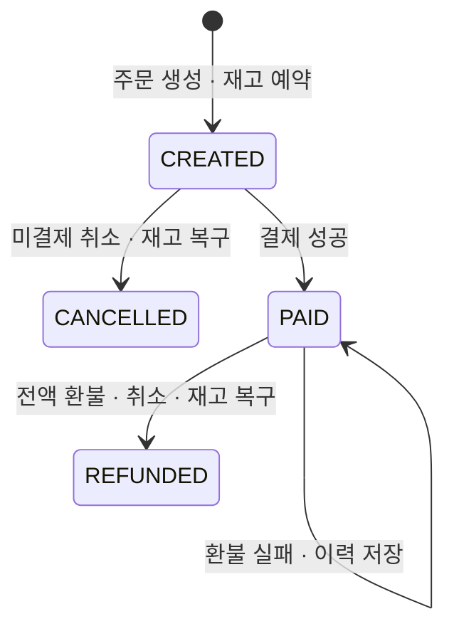

# 모의 전액 환불과 주문 취소 API

결제 완료 주문은 환불 API에서 **전액 환불·주문 취소·재고 복구를 함께** 처리합니다.
외부 결제사 호출이나 실제 돈의 이동이 없는 로컬 개발용 API입니다. 부분 환불은 지원하지 않습니다.
아래 예제는 기본 `local` 프로필용입니다. `prod`에서는 모의 환불 POST를 `404 MOCK_API_DISABLED`로 차단하고 본인 이력 조회는 유지합니다.

## 상태와 기록



환불 금액과 대상 결제 ID는 서버가 주문의 성공 결제에서 읽습니다. 요청으로 바꿀 수 없습니다.
성공하면 주문은 `REFUNDED`이며 `refundedAt`과 `cancelledAt`이 환불 성공 시각으로 설정됩니다.
`paidAt`과 원래 `SUCCEEDED` 결제 이력은 그대로 남습니다. 모든 시각은 UTC입니다.
실패하면 실패 이력만 저장하고, 주문은 `PAID`, 재고는 판매 상태로 유지합니다.

## 1. 로그인하고 결제 완료 주문 준비

[인증 API 안내](auth.md)의 1~3번으로 로그인한 PowerShell 터미널에서 실행합니다.
상품 ID와 재고를 먼저 확인하세요. 이미 결제 완료된 본인 주문이 있다면 그 주문 번호를 사용해도 됩니다.

```powershell
$base = 'http://localhost:8080'
Invoke-RestMethod "$base/products" | Format-Table
$headers['Idempotency-Key'] = [Guid]::NewGuid().ToString()
$order = Invoke-RestMethod -Method Post -Uri "$base/orders" -WebSession $session `
  -Headers $headers -ContentType 'application/json' -Body '{"productId":1,"quantity":1}'
$headers['Idempotency-Key'] = [Guid]::NewGuid().ToString()
$payment = Invoke-RestMethod -Method Post -Uri "$base/orders/$($order.orderId)/payments" `
  -WebSession $session -Headers $headers -ContentType 'application/json' -Body '{"result":"SUCCESS"}'
$refundUrl = "$base/orders/$($order.orderId)/refunds"
```

결제 후 `/cancel`을 호출하면 `409 REFUND_REQUIRED`입니다. 아래 환불 API를 사용하세요.

## 2. 환불 실패와 같은 요청의 재시도

```powershell
$headers['Idempotency-Key'] = [Guid]::NewGuid().ToString()
$failed = Invoke-RestMethod -Method Post -Uri $refundUrl -WebSession $session `
  -Headers $headers -ContentType 'application/json' -Body '{"result":"FAILURE"}'
$failed

# 같은 키·내용은 최초 실패 이력을 반환합니다. 추가 이력이 생기지 않습니다.
Invoke-RestMethod -Method Post -Uri $refundUrl -WebSession $session `
  -Headers $headers -ContentType 'application/json' -Body '{"result":"FAILURE"}'
```

새 시도는 성공·실패 모두 `201 Created`입니다. 이는 환불 이력을 생성했다는 뜻이며,
실제 환불 결과는 본문의 `status` (`SUCCEEDED` 또는 `FAILED`)로 확인합니다.
재시도는 `200 OK`, `Idempotency-Replayed: true`이며 동일한 `refundId`·금액·시각을 반환합니다.
실패 키의 결과를 `SUCCESS`로 바꾸면 `409 IDEMPOTENCY_KEY_REUSED`입니다. 새 시도에는 새 키를 쓰세요.

## 3. 새 키로 환불과 취소 완료

```powershell
$headers['Idempotency-Key'] = [Guid]::NewGuid().ToString()
$refunded = Invoke-RestMethod -Method Post -Uri $refundUrl -WebSession $session `
  -Headers $headers -ContentType 'application/json' -Body '{"result":"SUCCESS"}'
$refunded
Invoke-RestMethod "$base/orders/$($order.orderId)" -WebSession $session | ConvertTo-Json -Depth 5
Invoke-RestMethod $refundUrl -WebSession $session | Format-Table
Invoke-RestMethod "$base/products" | Format-Table

# 응답 유실을 가정한 재시도: 키를 바꾸지 않습니다. 재고는 다시 복구되지 않습니다.
Invoke-RestMethod -Method Post -Uri $refundUrl -WebSession $session `
  -Headers $headers -ContentType 'application/json' -Body '{"result":"SUCCESS"}'
```

예를 들어 15,000원 결제를 환불했다면 응답은 다음 형태입니다. ID와 시각은 예시입니다.

```json
{
  "refundId": 2,
  "orderId": 1,
  "paymentId": 1,
  "amount": 15000,
  "status": "SUCCEEDED",
  "createdAt": "2026-10-12T07:00:00Z"
}
```

주문 상태는 `REFUNDED`이고 주문 수량만큼 재고가 복구됩니다. 새 키로 다시 환불하거나 결제하면 `409`입니다.
환불 완료 뒤 `/cancel`을 반복해도 `200`과 현재 `REFUNDED` 주문을 반환하며 추가 재고 복구는 없습니다.

## API 계약

| 상황 | HTTP | 결과 |
|---|---|---|
| 결제 완료 주문에 새 키 + `SUCCESS` | 201 | `SUCCEEDED`, 주문 `REFUNDED`, 재고 복구 |
| 결제 완료 주문에 새 키 + `FAILURE` | 201 | `FAILED`, 주문 `PAID`와 재고 유지 |
| 같은 키 + 같은 결과 선택 | 200 | 최초 환불 이력, `Idempotency-Replayed: true` |
| 같은 키 + 다른 결과 선택 | 409 | `IDEMPOTENCY_KEY_REUSED` |
| 미결제·취소·환불 완료 주문에 새 키 | 409 | `ORDER_NOT_REFUNDABLE` |
| 성공 결제 이력 누락·금액 불일치 | 409 | `PAYMENT_STATE_CONFLICT` |
| 재고 복구 시 정수 범위 초과 | 409 | `STOCK_CAPACITY_EXCEEDED` |
| 요청 키 누락·잘못된 형식 | 400 | `INVALID_IDEMPOTENCY_KEY` |
| `result` 누락·잘못된 값·숫자 | 400 | `INVALID_REQUEST` |
| 없는 주문 또는 타인 주문 | 404 | `ORDER_NOT_FOUND` |
| 로그인 필요 / CSRF 오류 | 401 / 403 | `AUTH_REQUIRED` / `ACCESS_DENIED` |
| 잠금 충돌·대기 시간 초과 | 409 | `ORDER_CONFLICT` |

새 요청은 `Idempotency-Replayed: false`, `Location`은 해당 주문의 환불 이력 URL입니다.
`Idempotency-Key`는 필수이며 영문·숫자로 시작하는 1~64자의 영문·숫자·`._:-` 조합입니다.
주문별로 대소문자를 구분하며 주문 생성 키·결제 키와 별개로 보관합니다. 키는 만료하지 않습니다.
`GET /orders/{orderId}/refunds`는 본인 주문의 이력을 ID 오름차순으로 반환하며 이력이 없으면 `[]`입니다.

성공 환불 이후에도 과거 실패 환불 키는 최초 `FAILED`를 반환합니다.
과거 결제 키도 최초 승인 결과를 반환하므로 **현재 상태는 주문 조회와 환불 이력에서 확인**하세요.
재시작 후에도 모든 이력이 남지만 로그인 세션은 다시 만들어야 합니다.

## 트랜잭션과 검증

환불·결제·취소는 소유자 조건으로 같은 주문 행을 먼저 잠급니다. 성공 환불 시 상품 ID 순서로 상품 행을 잠급니다.
환불 이력·주문 상태·재고 복구를 하나의 DB 트랜잭션으로 처리하여 저장 실패 시 전부 롤백합니다.
모의 환불 실패는 정상적인 업무 결과로 이력을 커밋합니다. DB 저장 오류와 구분합니다.
성공 환불은 DB 유니크 제약으로도 주문당 한 건만 허용하고, 외래 키로 같은 주문의 결제만 연결합니다.

실제 MySQL 통합 테스트에서 성공·실패·재시도·소유자·CSRF·원 결제 보존,
같은 키와 다른 키의 동시 환불 20건, 환불·취소·결제 경쟁, 같은 상품의 다른 주문 환불,
실제 SQL 쓰기 후 오류의 전체 롤백과 재고 저장 범위 초과를 검증합니다.

같은 DB 안의 모의 환불만 지원합니다. 실제 환불 연동에는 외부 환불 결과의 확인·재시도·대조와 복구 절차가 필요합니다.
배포 프로필과 CI 구성은 [배포 안내](deployment.md)를 참고하세요.
